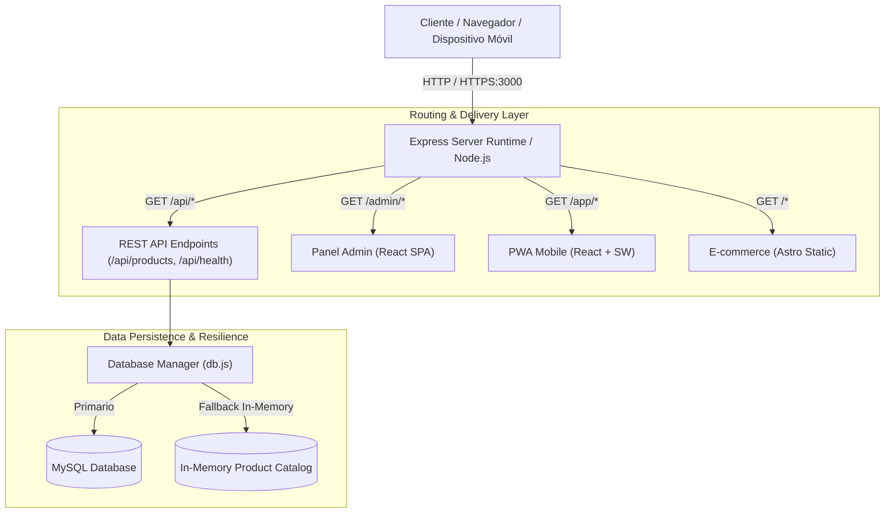
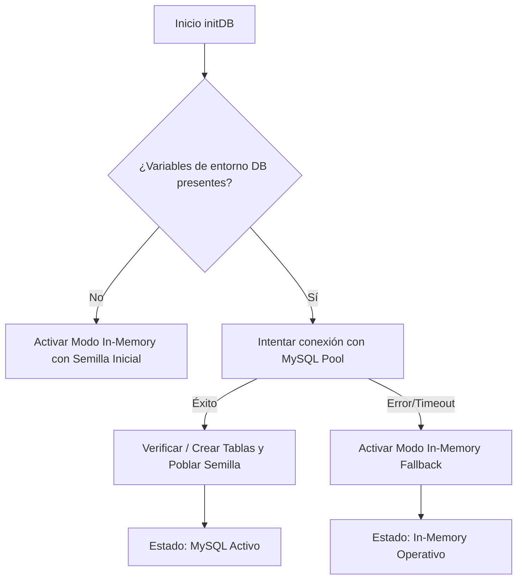
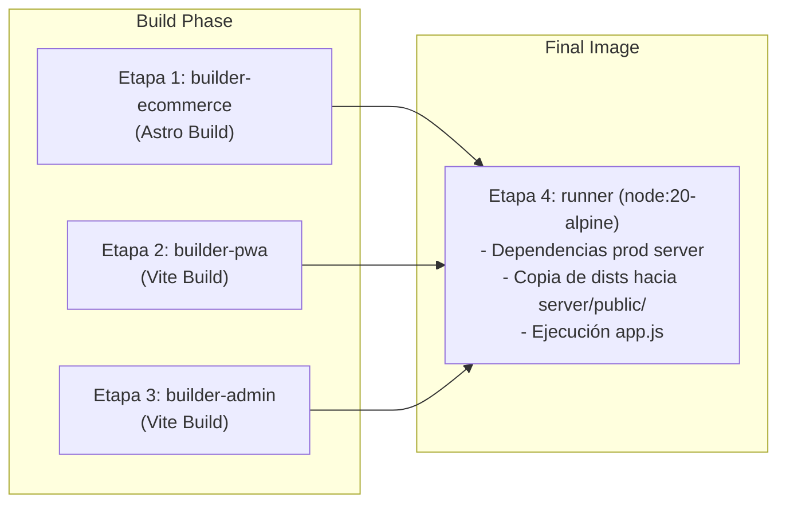

# 🏗️ ARCHITECTURE.md — Arquitectura de Software de RapidCorporate

Este documento describe la arquitectura técnica, los componentes clave, los patrones de diseño y las decisiones de infraestructura de la plataforma **RapidCorporate**.

---

## 🧭 1. Resumen Ejecutivo y Visión Arquitectónica

**RapidCorporate** está diseñado bajo el patrón **Single-Port Unified Monorepo (Monolito de Entrega Unificada)**. Su objetivo es proporcionar un ecosistema completo para negocios o masterclasses que combina:

1. **E-commerce público de alta velocidad**: Generación estática optimizada con Astro.
2. **PWA Mobile**: Aplicación web progresiva orientada a usuarios móviles con soporte offline (React + Vite).
3. **Panel Administrativo (Backoffice)**: Single Page Application para gestión de inventario y estado operativo (React + Vite).
4. **Backend API & Servidor de Contenidos**: Servicio Express unificado que maneja la persistencia y sirve las 3 interfaces.



---

## 🧩 2. Componentes del Sistema

### 2.1. Frontend: E-commerce (`apps/ecommerce`)
- **Framework**: [Astro 4](https://astro.build/)
- **Estrategia de Renderizado**: SSG (Static Site Generation), con `output: 'static'` y `build.format: 'directory'`.
- **Ruta Servida**: `/` (Raíz del dominio).
- **Propósito**: Máxima velocidad de carga, SEO técnico óptimo y bajo uso de memoria para visitantes de la tienda.

### 2.2. Frontend: PWA Mobile (`apps/pwa`)
- **Framework**: React 18 + Vite.
- **Ruta Servida**: `/app` (con `base: '/app/'` en Vite).
- **Capacidades PWA**:
  - `manifest.json`: Definición de tema, pantalla de inicio y nombres.
  - `sw.js`: Service worker para captura de eventos offline y cacheo de shell.
  - Eventos de instalación `beforeinstallprompt` controlados desde la interfaz.

### 2.3. Frontend: Panel de Control Administrativo (`apps/admin`)
- **Framework**: React 18 + Vite.
- **Ruta Servida**: `/admin` (con `base: '/admin/'` en Vite).
- **Propósito**: Gestión administrativa, monitorización del estado de conexión a la base de datos (MySQL vs Memoria) y administración de productos.

### 2.4. Backend: API y Servidor de Entrega (`server`)
- **Tecnología**: Node.js + Express + `mysql2/promise`.
- **Responsabilidades**:
  - Proveer API REST en `/api/*`.
  - Servir los artefactos estáticos compilados ubicados en `server/public/{ecommerce,pwa,admin}`.
  - Enrutamiento SPA con fallback (`res.sendFile(index.html)`) para `/admin/*` y `/app/*`.
  - Pantallas informativas de diagnóstico en caso de que algún frontend no haya sido compilado aún.

---

## 💾 3. Patrón de Resiliencia de Datos (Dual-Mode Data Bridge)

Uno de los principales retos en despliegues automatizados (CI/CD en Dokploy) y talleres en vivo es la disponibilidad inmediata de bases de datos. Para evitar que caídas de red o demoras en el aprovisionamiento de MySQL bloqueen el arranque de la aplicación, el módulo [`server/src/db.js`](file:///d:/BDeveloper/rapidcorporate/server/src/db.js) opera bajo un patrón de **Tolerancia a Fallos en Cascada**:



### Endpoints de Diagnóstico y Proxy:
- **`GET /api/health`**: Expone el modo de operación (`mysql` o `in-memory`), el host configurado, uptime y estado de salud.
- **`GET /api/debug-network`**: Herramienta de introspección para contenedores Docker que verifica resolución DNS interna e inspecciona puertos TCP 3306 en subredes Docker (`172.17.x.x` y `172.18.x.x`).
- **`ALL /api/idempiere-proxy?target=`**: Proxy inverso interno que reenvía peticiones REST HTTP/JSON directamente desde Node.js hacia iDempiere ERP (o cualquier servicio externo), eliminando restricciones CORS del navegador sin depender de terceros.

---

## 🌐 4. Arquitectura de Bypass CORS Multi-Modo (Integración ERP)

El navegador impone la política del mismo origen (Same-Origin Policy). Cuando la SPA de administración realiza peticiones a `test.idempiere.org:443`, el navegador bloquea la respuesta a menos que exista un mecanismo de intermediación:

```mermaid
flowchart LR
    Browser["Navegador (Panel Admin)"] -->|1. POST /api/idempiere-proxy?target=...| NodeProxy["Express Backend (/api/idempiere-proxy)"]
    NodeProxy -->|2. HTTP Request (Server-to-Server)| IDempiere["iDempiere REST API v1\n(test.idempiere.org:443)"]
    IDempiere -->|3. JSON Response + Bearer Token| NodeProxy
    NodeProxy -->|4. JSON Response (Same Origin / 200 OK)| Browser
```

### Modos Soportados en el Frontend:
1. **`local` (Opción 2 - Por Defecto y Recomendado)**: Pasa a través del endpoint `/api/idempiere-proxy` en Node.js. Cero latencias externas, sin dependencia de API keys y 100% de disponibilidad.
2. **`none` (Opción 1 - Directo)**: Conexión directa contra la URL de iDempiere sin intermediarios.
3. **`allorigins` (Opción 3 - Alternativa Pública)**: Utiliza `https://api.allorigins.win/raw?url=` como proxy público de respaldo.
4. **`corsproxy` (Opción 4 - Con Key)**: `https://corsproxy.io/?key=...`. Si se intenta invocar sin clave, el cliente conmuta automáticamente a `local` para prevenir el error `403 keyless_legacy_url`.

---

## 🚢 5. Pipeline de Contenedorización (Docker Multi-Stage)

El [`Dockerfile`](file:///d:/BDeveloper/rapidcorporate/Dockerfile) está estructurado en 4 etapas para minimizar el tamaño de la imagen final y garantizar compilaciones herméticas:



### Ventajas de este Enfoque:
- **Sin herramientas de build en producción**: Node.js, Astro y Vite no residen en el runtime final.
- **Cero dependencias cruzadas**: Cada frontend gestiona sus propias dependencias sin colisionar en versiones.
- **Un solo puerto expuesto**: Dokploy solo necesita mapear el puerto `3000` con un único certificado SSL Traefik.

---

## 📐 6. Reglas y Convenciones de Arquitectura

1. **Aislamiento de Frontends**: Cada aplicación en `apps/` es independiente y se compila a su propio directorio `dist/`.
2. **Subrutas Absolutas en Vite**: Las configuraciones de `base` en `vite.config.js` deben coincidir estrictamente con el prefijo montado por Express (`/admin/` y `/app/`).
3. **Consistencia de Modelos**: Toda modificación en los atributos de productos (`id`, `name`, `category`, `price`, `stock`, `image`, `description`) debe reflejarse en:
   - Esquema DDL en `db.js`.
   - Array `INITIAL_PRODUCTS` en `db.js`.
   - Tipos o vistas en los frontends (`apps/ecommerce`, `apps/pwa`, `apps/admin`).
4. **Idempotencia en Base de Datos**: Los scripts de inicialización usan `CREATE TABLE IF NOT EXISTS` y si la tabla está vacía, se realiza un sembrado inicial sin duplicar datos.

---

*Documento de Arquitectura — Noviembre 2026 (Actualizado con Módulo de Proxying Local y Mitigación CORS)*

