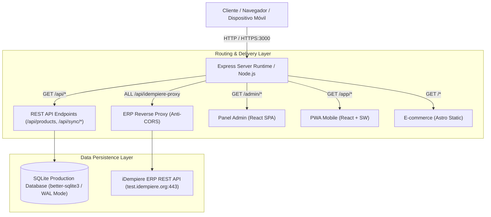

# 🏗️ ARCHITECTURE.md — Arquitectura de Software de RapidCorporate

Este documento describe la arquitectura técnica, los componentes clave, los patrones de persistencia, la integración con el ERP iDempiere y las decisiones de infraestructura de la plataforma **RapidCorporate**.

---

## 🧭 1. Resumen Ejecutivo y Visión Arquitectónica

**RapidCorporate** está diseñado bajo el patrón **Single-Port Unified Monorepo (Monolito de Entrega Unificada)**. Su objetivo es proporcionar un ecosistema completo para negocios o masterclasses que combina:

1. **E-commerce público de alta velocidad**: Generación estática optimizada con Astro.
2. **PWA Mobile**: Aplicación web progresiva orientada a usuarios móviles con soporte offline (React + Vite).
3. **Panel Administrativo (Backoffice)**: Single Page Application para gestión de inventario, sincronización de catálogos ERP y administración de clientes (React + Vite).
4. **Backend API & Servidor de Contenidos**: Servicio Express unificado que maneja la persistencia y sirve las 3 interfaces simultáneamente bajo el puerto `3000`.



---

## 🧩 2. Componentes del Sistema

### 2.1. Frontend: E-commerce (`apps/ecommerce`)
- **Framework**: [Astro 4](https://astro.build/)
- **Estrategia de Renderizado**: SSG (Static Site Generation), con `output: 'static'` y `build.format: 'directory'`.
- **Ruta Servida**: `/` (Raíz del dominio).
- **Propósito**: Máxima velocidad de carga, SEO técnico óptimo y bajo uso de memoria para visitantes de la tienda.

### 2.2. Frontend: PWA Mobile (`apps/pwa`)
- **Framework**: React 18 + Vite.
- **Ruta Servida**: `/app` (con `base: '/app/'` en Vite).
- **Capacidades PWA**:
  - `manifest.json`: Definición de tema, pantalla de inicio y nombres.
  - `sw.js`: Service worker para captura de eventos offline y cacheo de shell.
  - Eventos de instalación `beforeinstallprompt` controlados desde la interfaz.

### 2.3. Frontend: Panel de Control Administrativo (`apps/admin`)
- **Framework**: React 18 + Vite.
- **Ruta Servida**: `/admin` (con `base: '/admin/'` en Vite).
- **Propósito**: Gestión administrativa integral:
  - Autenticación en 1 Paso o 2 Pasos con iDempiere ERP.
  - Mantenimiento completo (CRUD) de Categorías de Productos, Productos, Listas y Precios, Categorías de Clientes y Clientes.
  - Visualización en **Solo Lectura** del Catálogo de Impuestos (`C_Tax`).
  - Monitor de estado de base de datos SQLite y auditoría de sincronizaciones (`sync_logs`).

### 2.4. Backend: API y Servidor de Entrega (`server`)
- **Tecnología**: Node.js + Express + `better-sqlite3`.
- **Responsabilidades**:
  - Proveer API REST en `/api/*`.
  - Servir los artefactos estáticos compilados ubicados en `server/public/{ecommerce,pwa,admin}`.
  - Enrutamiento SPA con fallback (`res.sendFile(index.html)`) para `/admin/*` y `/app/*`.
  - Endpoint de Proxy Server-to-Server `/api/idempiere-proxy` para mitigación 100% efectiva de restricciones CORS con ERP iDempiere.

---

## 💾 3. Capa de Persistencia: SQLite de Producción (`better-sqlite3`)

Se ha descartado el uso de MySQL en favor de **SQLite** como motor de datos unificado para producción y desarrollo:

1. **Rendimiento y Modo WAL**: Se configura con `journal_mode = WAL` (Write-Ahead Logging) y `synchronous = NORMAL`, permitiendo lecturas concurrentes sin bloqueo y escrituras atómicas de alta velocidad.
2. **Integridad Referencial**: Se activa `PRAGMA foreign_keys = ON;` para asegurar relaciones válidas entre productos, categorías, versiones de listas y clientes.
3. **Cero Dependencia de Red**: Elimina los problemas de resolución DNS, credenciales expiradas o latencia de red típicos de servidores de base de datos separados.
4. **Almacenamiento Persistente en Docker/Dokploy**: El archivo reside en `server/data/database.sqlite`, fácilmente mapeable como un volumen Docker (`-v /data/sqlite:/app/server/data`).

### Catálogos y Tablas en SQLite:
| Tabla | Modelo ERP Mapeado | Mantenimiento Local (CRUD) | Descripción |
| :--- | :--- | :---: | :--- |
| `products` | `M_Product` | ✅ Sí | Catálogo de productos con SKU, precio, stock, imagen |
| `product_categories` | `M_Product_Category` | ✅ Sí | Clasificación de artículos de la tienda |
| `price_lists` | `M_PriceList` | ✅ Sí | Listas de precios por divisa |
| `price_list_versions`| `M_PriceList_Version` | ✅ Sí | Versiones con vigencia temporal |
| `product_prices` | `M_ProductPrice` | ✅ Sí | Precios estándar, de lista y límite por producto |
| `customer_categories`| `C_BP_Group` | ✅ Sí | Grupos y clasificación de socios de negocio |
| `customers` | `C_BPartner` | ✅ Sí | Clientes y proveedores con RUC/TaxID, contacto |
| `taxes` | `C_Tax` | 🔒 **Solo Lectura** | Tasas fiscales maestras sincronizadas desde ERP |
| `sync_logs` | *Nativo Auditoría* | Auditoría | Trazabilidad de transacciones de sincronización |

---

## 🔐 4. Arquitectura de Autenticación con iDempiere ERP (1 y 2 Pasos)

La plataforma implementa las dos variantes oficiales de autenticación con el API REST de iDempiere:

### Flujo en 2 Pasos (Asistido por Contexto)
1. **Paso 1 (Credenciales Básicas)**: El usuario introduce `userName` y `password`. El frontend envía `POST /api/v1/auth/tokens`. iDempiere valida y retorna un token temporal JWT (`tempToken`) y la lista de empresas asociadas (`clients`).
2. **Cascada de Selección**:
   - `GET /api/v1/auth/roles?client={clientId}` (con Bearer tempToken).
   - `GET /api/v1/auth/organizations?client={clientId}&role={roleId}`.
   - `GET /api/v1/auth/warehouses?client={clientId}&role={roleId}&organization={organizationId}`.
3. **Paso 2 (Confirmación Final)**: Se envía `PUT /api/v1/auth/tokens` con el cuerpo plano `{ clientId, roleId, organizationId, warehouseId, language }`. iDempiere devuelve el token JWT final operativo de sesión.

### Flujo en 1 Paso (Directo)
Envía directamente `POST /api/v1/auth/tokens` con un objeto que incluye las credenciales y el bloque anidado `parameters` con los IDs de cliente, rol, organización y almacén preconfigurados.

---

## 🌐 5. Mitigación de CORS mediante Proxy Local Server-to-Server

Debido a que `corsproxy.io` ahora rechaza URLs anónimas con error HTTP 403 (`keyless_legacy_url`), la plataforma utiliza por defecto el endpoint interno de Express:

```mermaid
flowchart LR
    Browser["Panel Admin (React)"] -->|1. Fetch /api/idempiere-proxy?target=...| Express["Node.js Express Proxy (/api/idempiere-proxy)"]
    Express -->|2. Server-to-Server HTTPS| ERP["iDempiere ERP (test.idempiere.org:443)"]
    ERP -->|3. JSON Payload| Express
    Express -->|4. Response (Same-Origin)| Browser
```

Esta solución es 100% independiente de servicios de proxy externos, eliminando bloqueos de CORS y fallos por cuotas de terceros.

---

## 🚀 6. Despliegue en Dokploy vía Docker Multi-Stage

El archivo [`Dockerfile`](file:///d:/BDeveloper/rapidcorporate/Dockerfile) ejecuta una compilación optimizada en 4 etapas:
- **Etapa 1**: Compilación de Astro hacia `apps/ecommerce/dist`.
- **Etapa 2**: Compilación de PWA hacia `apps/pwa/dist`.
- **Etapa 3**: Compilación de Admin hacia `apps/admin/dist`.
- **Etapa 4**: Imagen base `node:20-alpine` con `python3 make g++` (para compilar las extensiones nativas C++ de `better-sqlite3`), dependencias de producción de `server`, copia de artefactos a `server/public/*` e inicio del servicio en el puerto `3000`.
